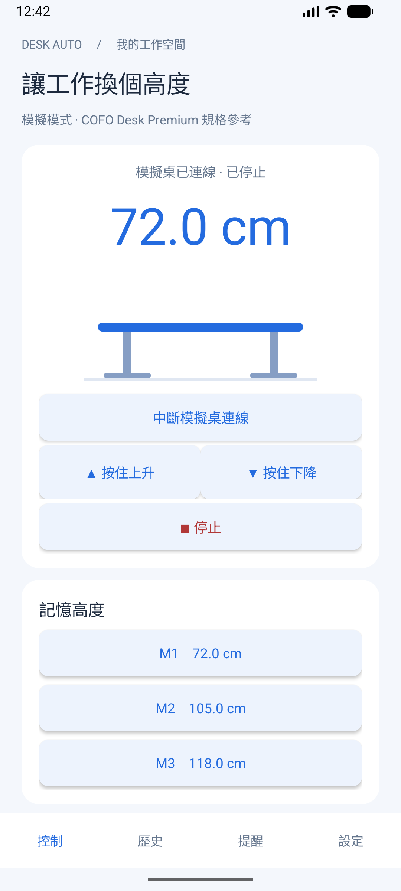
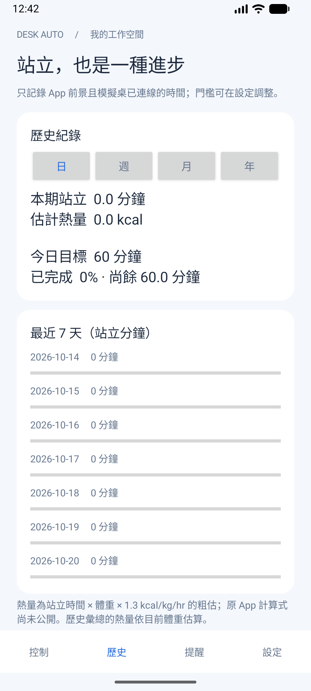
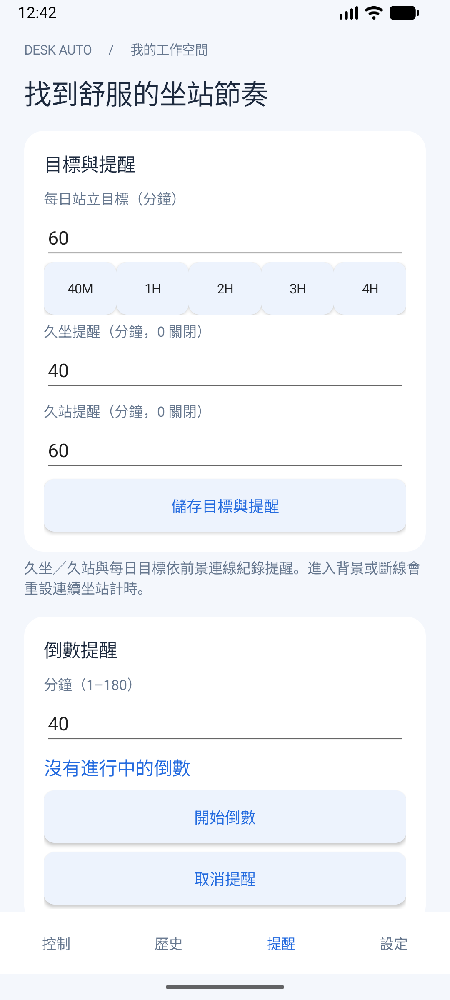
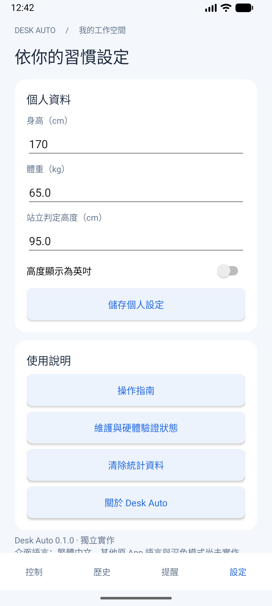

# 驗證紀錄

日期：2026-10-20（Asia/Taipei）。對象：目前工作樹中的 Android `dev.cofodesk.auto` 0.1.0。本次另已操作原 App 的教學／主要設定與提醒，並使用 REA；實體桌仍未驗證。

## 已執行

| 項目 | 結果 | 直接證據 |
| --- | --- | --- |
| JVM 核心測試 | 51 通過、0 失敗、0 跳過 | `app/build/test-results/testDebugUnitTest/TEST-dev.cofodesk.auto.core.DeskSessionTest.xml`（24）、`SimulatedDeskContractTest`（5）、`ScriptedDeskContractTest`（10）、`ActivityHistoryTest`（4）、`CofoProtocolTest`（4）、`StandingCaloriesTest`（4） |
| Android 操作測試 | 18 通過、0 失敗、0 跳過 | `app/build/outputs/androidTest-results/connected/debug/TEST-Medium_Phone_API_36.1(AVD) - 16-_app-.xml` |
| Android lint | 0 errors、3 warnings | 強制重新產生的 `app/build/reports/lint-results-debug.html` |
| APK 安裝與冷啟動 | 成功，Activity `dev.cofodesk.auto/.MainActivity` | `adb install -r` 回覆 Success、`am start -W` 回覆 Status ok／LaunchState COLD |
| 四頁視覺檢查 | 控制、歷史、提醒與設定均可見，操作列保留系統邊界 | 下方本次模擬器截圖，已目視檢查 |
| 模擬器權限矩陣 | BLE 拒絕後模擬桌仍可用；掃描會結束或明確回報不可用；通知拒絕後倒數／取消仍有效 | `python3 scripts/emulator-permission-smoke.py` 結束碼 0，輸出 E01、E02/E03、E05 的 3 個 PASS。E02/E03 是替代分支，不代表兩條都已測到 |

環境：macOS arm64、OpenJDK 21.0.10、Android SDK 36、AVD `Medium_Phone_API_36.1`／`emulator-5554`。裝置回報 API 36；AVD 名稱不是額外 API 相容性證明。

最新通過（2026-10-20 review 修正後）：51 個 JVM 測試（含 DeskPort 契約）、12 個 AppFlow + 6 個 LocaleAppearance = 18 個 Android 測試，加上 66 個 Python CLI 測試，共 135 個自動測試。MainActivity 拆成各分頁類別後重跑全部 Android 測試與權限矩陣，並以模擬器截圖比對控制頁版面。AppFlow 改用所選語言的 resource 比對文字，另以一個測試明確斷言預設語言為繁中；通知加入有界等待，驗證真正送達，未降低斷言。權限矩陣腳本會先確認 App 介面是繁中，否則立即中止並說明原因；已實測英文介面時以結束碼 1 中止。

最後完整測試指令：

```sh
ANDROID_HOME=/Users/tkain/Library/Android/sdk ./gradlew :app:testDebugUnitTest :app:lintDebug :app:connectedDebugAndroidTest --console=plain
```

Lint 增量報告曾保留修改前的 manifest 訊息，因此又執行 `:app:lintDebug --rerun-tasks`。最後 3 項 warning 是 targetSdk 36 並非最新、BLE scan flag 在 API 31 前忽略、Gradle 有較新版本；沒有關閉 lint 或建立忽略 baseline。

APK：`app/build/outputs/apk/debug/app-debug.apk`，SHA-256：`66196ff744cc521d7e52b5b75f77002b33299487ecb40390648fe896f40a86f3`。這是本次 debug 安裝包，重建後雜湊可改變。

權限矩陣在 UI 測試完成後另外執行，結束時還原原權限並重新啟動本專案 App。早期權限矩陣只操作本專案 App。後續使用者自行安裝了原 COFO App 1.0.10；本次已觀察其教學／設定畫面與初始化權限，未連桌或提交回饋。

## 畫面

| 控制 | 歷史 |
| --- | --- |
|  |  |

| 提醒 | 設定 |
| --- | --- |
|  |  |

截圖中的狀態列／系統外觀來自現有 AVD，不是原生 iOS 版本。

## 完成狀態審核

| README 原始 TODO | 目前證據 | 判定 |
| --- | --- | --- |
| List all functions | 25 個有來源 ID、官方截圖／手冊、原 App 主要畫面與 REA；連線後流程尚缺 | 公開資料盤點完成；「所有功能」尚未證明 |
| Design checklist and test cases | `test-plan.md` 包含前置、操作、預期與功能對照，以及原 App／實機矩陣；135 個自動測試通過（JVM 51、Android 18、Python 66） | 已完成測試設計與目前軟體驗證；人工／實機案例另行追蹤 |
| Clone app | 可安裝的原生 App、模擬控制、統計、提醒、保存、BLE 診斷與測試 | 模擬版本已完成；完整 BLE／原 App 相容尚未完成 |
| Plan further auto features | `automation.md` 含 A1–A6 的順序、條件、取消、優先權與驗收 | 規劃完成，未聲稱自動移動已實作 |

## 尚未驗證／實作

- 實體 BLE 連線、命令、停止保證、高度回報、控制盒故障、硬體面板互動、配對／QR 流程。
- 原 App 連線後 runtime 與維護 WebView 內容／外部連結。M 記憶語意、桌子設定、熱量、語言與外觀已取得靜態／畫面證據；替代 App 尚有記憶手勢、原始預設、推薦高度／資料單位、提醒鈴聲等相容性差異。
- Android API 26–35／37 執行期、橫向／放大字體、實體手機省電與開機後行為。
- OS 背景 alarm 的實際送達延遲。測試證明 receiver 可建立通知、取消能移除，不能據此保證 alarm 準時。
- 真桌站立時間及實際資料的數值對照。純公式與期間截斷已比對 REA 靜態證據。

這些缺口保留在 README 未完成項與 `test-plan.md` E／H 案例；不以模擬結果代替。

## 五語與深色畫面（本次新增）

[英文](verification-assets/locales/english.png)、[日文](verification-assets/locales/japanese.png)、[簡中](verification-assets/locales/simplified-chinese.png)、[韓文](verification-assets/locales/korean.png)、[繁中](verification-assets/locales/traditional-chinese.png)、[深色控制](verification-assets/locales/dark-control.png) 均已目視核對。畫面採測試資料（例如 M1=90cm），不表示原 App 預設值。Gradle 測試清理了私有截圖，因此以保留資料的 instrumentation 重跑 LocaleAppearance 5 案後取回；5 案再次通過。

## CLI（2026-10-20）

- Python 3.14.8、macOS arm64：`python3 -m unittest discover -s tests -v` 及 `.venv/bin/python -m unittest discover -s tests -q`，40 通過、0 失敗、0 跳過。
- `.venv/bin/python -m pip install -e '.[ble]'` 成功安裝 `cofo-desk-auto 0.1.0`、Bleak 3.0.2 與 PyObjC 12.2.2；`pip check` 沒有相依衝突。
- 已檢查安裝版 Bleak 的 `write_gatt_char`／`start_notify`／`discover` 簽名與目前呼叫相容。`cofo-desk --version` 輸出 0.1.0、`--help` 列出 8 個子指令。
- 程序層測試涵蓋模擬狀態跨指令保存、毫米／公分／英吋目標、限時升降／停止、逾時後停止、Ctrl-C 結束碼 130、互斥檔案鎖、無效輸入及損壞狀態拒絕。BLE 入口使用獨立 GATT fixture／mock，不會碰觸實體桌。
- 停止可靠性更新（2026-10-20）：當時 60 通過（之後輸出重構再加 1 個，現為 61）、0 失敗、0 跳過。新增 SIGTERM／SIGHUP／SIGINT 在移動中送 STOP 並分別以 143／129／130 結束、清理中重複訊號不中斷 STOP、STOP 與斷線同時失敗的回報、獨立 stop 的 STOP→登入→STOP 次序（無登入 service、登入閘門、登入卡住、中途斷線），以及模擬器拒收 checksum／結尾錯誤的目標封包。訊號測試使用 GATT fixture 與模擬裝置，沒有連真桌。
- 真桌首次連線與移動案例見後面兩節；碰撞與移動中斷線仍未驗證。此次 CLI 工作沒有變更 Android App。

操作說明與控制限制見 [CLI 文件](cli.md)。

## 真桌首次連線（2026-10-20）

使用者在桌前監看，以 `--trace` 執行 [first-contact script](hardware-evidence/2026-10-20-first-contact.sh)，完整輸出見 [log](hardware-evidence/2026-10-20-first-contact.log)。協定細節整理在 [REA 調查的真桌觀察](reverse-engineering.md#真桌觀察2026-10-20)。

| 步驟 | 結果 |
| --- | --- |
| `inspect` | 成功；`fe60` profile 與 Device Information service，沒有登入 service |
| `status` | 高度 63.0 cm，面板顯示 63；單位 cm；上下限 630–1280 mm |
| `stop` | 只送一次 STOP（沒有登入 service），寫入成功；桌子原本就靜止，無法觀察效果 |
| `up --seconds 0.1` | 寫入一次 UP、160 ms 後 STOP；高度 630 → 631 mm，面板仍為 63 |
| `down --seconds 0.1` | 高度 631 已在下限 630 的 1 mm 安全距離內，CLI 判定到達限位，只送 STOP，未送 DOWN |

依這次紀錄，CLI 的通知解析改為驗 checksum 並跨通知重組；把整份紀錄依序重新解析，得到 50 筆高度、13 筆上下限、12 筆單位，沒有任何錯誤或異常事件。

macOS 的藍牙權限屬於啟動終端機的 App；本次在權限生效前就已啟動的 tmux 內被拒絕，改在新開的 Ghostty 分頁執行。

## 真桌移動案例（2026-10-20）

使用者在桌前監看，每個會移動的步驟都先輸入 `y` 同意。腳本是 [motion cases script](hardware-evidence/2026-10-20-motion-cases.sh)，會移動的步驟用 [motion probe](hardware-evidence/2026-10-20-motion-probe.py) 執行 CLI 的 `Desk` 移動程式碼，並在 STOP 後繼續記錄高度。完整紀錄見 [log](hardware-evidence/2026-10-20-motion-cases.log)，解讀見 [REA 調查的移動案例](reverse-engineering.md#移動案例2026-10-20)。

| 步驟 | 結果 |
| --- | --- |
| 0. `status` | 631 mm，面板 63 |
| 1a. 點動上升 1 秒 | STOP 時 646、最後 661，STOP 後 0.63 秒靜止；面板 66 |
| 1b. CLI `up --seconds 3`，第一個 UP 後 1 秒送 SIGTERM | 結束碼 143，STOP 寫入完成；STOP 時 670、最後 686，只上升 25 mm；面板 69 |
| 2. `goto` 目前高度 + 5 mm（691），逾時 1 秒 | 686 → 690，進入容差後送 STOP；面板 69；目標單位證實是 mm |
| 3. 只送一次 UP，不重送、不送 STOP | 690 → 699，寫入後約 1.15 秒自己停下；面板 70 |
| 4. 點動下降最多 6 秒 | 約 3 秒回到 630，CLI 判定到達限位並送 STOP；面板 63 |

步驟 4 的面板高度，使用者在腳本中誤輸入為 64，事後更正為 63。
